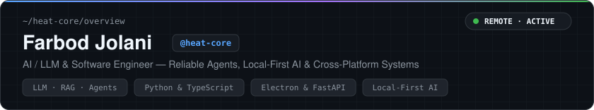
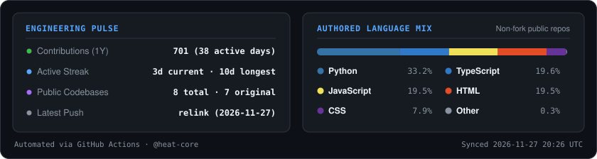

  <picture>
    <source media="(prefers-color-scheme: dark)" srcset="./assets/hero-dark.svg" />
    <source media="(prefers-color-scheme: light)" srcset="./assets/hero-light.svg" />
    
  </picture>

   

  <picture>
    <source media="(prefers-color-scheme: dark)" srcset="https://readme-typing-svg.demolab.com?font=JetBrains+Mono&amp;weight=500&amp;size=14&amp;duration=3000&amp;pause=1100&amp;color=58A6FF&amp;center=true&amp;vCenter=true&amp;width=720&amp;height=28&amp;lines=Building+deterministic+LLM%2C+RAG+%26+agentic+workflows;Engineering+local-first+desktop+AI+%26+self-hosted+tools;Python+%C2%B7+TypeScript+%C2%B7+FastAPI+%C2%B7+Electron+%C2%B7+Docker" />
    <source media="(prefers-color-scheme: light)" srcset="https://readme-typing-svg.demolab.com?font=JetBrains+Mono&amp;weight=500&amp;size=14&amp;duration=3000&amp;pause=1100&amp;color=0969DA&amp;center=true&amp;vCenter=true&amp;width=720&amp;height=28&amp;lines=Building+deterministic+LLM%2C+RAG+%26+agentic+workflows;Engineering+local-first+desktop+AI+%26+self-hosted+tools;Python+%C2%B7+TypeScript+%C2%B7+FastAPI+%C2%B7+Electron+%C2%B7+Docker" />
    
  </picture>

  

    <a href="https://www.linkedin.com/in/farbodjolani" target="_blank">
      <picture>
        <source media="(prefers-color-scheme: dark)" srcset="./assets/badge-linkedin-dark.svg" />
        <source media="(prefers-color-scheme: light)" srcset="./assets/badge-linkedin-light.svg" />
        
      </picture>
    </a>
    &nbsp;
    <a href="mailto:farbod.jolani00@gmail.com">
      <picture>
        <source media="(prefers-color-scheme: dark)" srcset="./assets/badge-email-dark.svg" />
        <source media="(prefers-color-scheme: light)" srcset="./assets/badge-email-light.svg" />
        
      </picture>
    </a>
    &nbsp;
    <a href="https://github.com/heat-core?tab=repositories">
      <picture>
        <source media="(prefers-color-scheme: dark)" srcset="./assets/badge-repos-dark.svg" />
        <source media="(prefers-color-scheme: light)" srcset="./assets/badge-repos-light.svg" />
        
      </picture>
    </a>
  

---

### Focus & Engineering Philosophy

- **AI, RAG & Agentic Systems:** Building deterministic retrieval pipelines, multimodal vision/speech workflows (`Gemini`, `OpenAI`, `Whisper`), and observable, test-driven agents rather than brittle prompt wrappers.
- **Local-First & Self-Hosted Software:** Shipping privacy-preserving desktop suites and offline-first web applications backed by `FastAPI`, `Electron`, `React 19`, `SQLite`, `PWA`, and `Docker`.
- **Systems & Developer Tooling:** Working across cross-platform connectivity (`C`, `Kotlin`, `Swift`), IDE RTL/BiDi patches, and interactive Python internals tooling.

---

### Selected Projects

| Project | Overview | Stack |
| :--- | :--- | :--- |
| [**instagram-vault**](https://github.com/heat-core/instagram-vault) | Local-first desktop suite to permanently archive and enrich Instagram collections with multimodal AI vision taxonomy, Whisper audio transcription, and native Windows drag-and-drop. | `TypeScript` `React 19` `Electron` `FastAPI` `Python` |
| [**plotline**](https://github.com/heat-core/plotline) (`v1.1.0`) | Self-hosted, offline-first TV, Anime &amp; Movie tracker with exact binge-time analytics, Netflix-style family profiles, Jellyfin/Plex webhook scrobbling, Docker, and PWA support. | `Python` `SQLite` `Docker` `PWA` `JavaScript` |
| [**relink**](https://github.com/heat-core/relink) (`v1.3.0-beta.8`) | Open-source Android-to-iPhone cellular companion enabling calls, SMS, and contact sync over adaptive Bluetooth and local Wi-Fi *(derivative of [Tether](https://github.com/amirwmr/tether))*. | `C` `Kotlin` `Swift` `Bluetooth` `CallKit` |
| [**antigravity-rtl**](https://github.com/heat-core/antigravity-rtl) (`v1.1.0`) | Permanent stylesheet patch and AI agent formatting rules resolving Persian/Arabic RTL &amp; BiDi rendering defects in Google Antigravity IDE. | `Python` `CSS` `JavaScript` `PowerShell` |
| [**python-learning-arena**](https://github.com/heat-core/python-learning-arena) | Interactive 20-exercise leveled Python engineering suite featuring an in-browser runner, automated unit test framework, and technical interview quizzes. | `Python` `JavaScript` `Unit Testing` |
| [**learning-journal**](https://github.com/heat-core/learning-journal) | Structured 52-week engineering log covering Python internals, concurrency, classical ML, PyTorch, and production LLM/RAG architectures. | `Python` `System Design` `RAG` |

---

### Core Stack

  <picture>
    <source media="(prefers-color-scheme: dark)" srcset="https://skillicons.dev/icons?i=python%2Cts%2Cjs%2Creact%2Cfastapi%2Celectron%2Cnodejs%2Cdocker%2Csqlite%2Ckotlin%2Cswift%2Cc%2Cgit%2Clinux&amp;perline=14&amp;theme=dark" />
    <source media="(prefers-color-scheme: light)" srcset="https://skillicons.dev/icons?i=python%2Cts%2Cjs%2Creact%2Cfastapi%2Celectron%2Cnodejs%2Cdocker%2Csqlite%2Ckotlin%2Cswift%2Cc%2Cgit%2Clinux&amp;perline=14&amp;theme=light" />
    
  </picture>

---

### Live Telemetry & Activity

  <picture>
    <source media="(prefers-color-scheme: dark)" srcset="./assets/telemetry-dark.svg" />
    <source media="(prefers-color-scheme: light)" srcset="./assets/telemetry-light.svg" />
    
  </picture>

    

  <picture>
    <source media="(prefers-color-scheme: dark)" srcset="https://raw.githubusercontent.com/heat-core/heat-core/output/github-contribution-grid-snake-dark.svg?v=2" />
    <source media="(prefers-color-scheme: light)" srcset="https://raw.githubusercontent.com/heat-core/heat-core/output/github-contribution-grid-snake.svg?v=2" />
    
  </picture>

